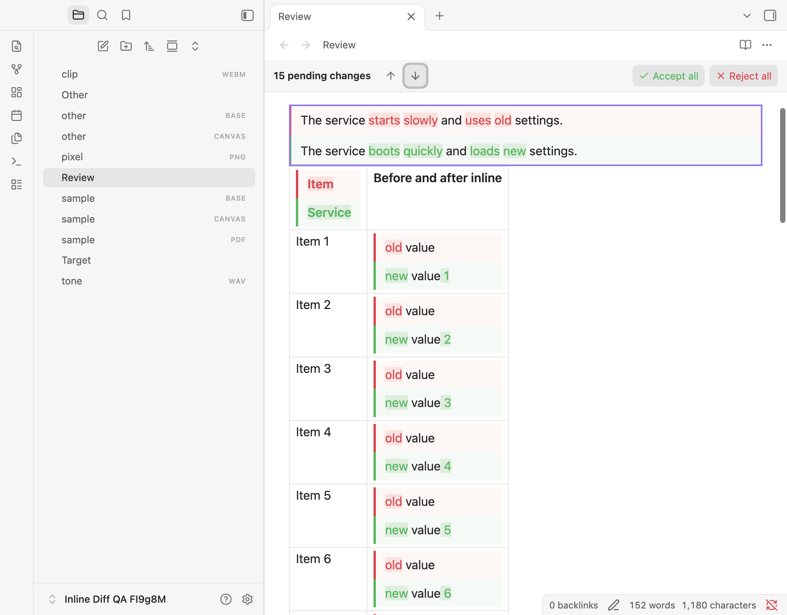

# Inline Diff

Review an agent's proposed changes to an Obsidian note, then accept or reject each edit.



Requires desktop Obsidian **1.14.5 or newer**. The original baseline was 1.14.5; granular rendering is verified on 1.15.0 on macOS. Mobile support is not included.

```markdown
The timeout is {~~10~>30~~} seconds.

| Feature | Status |
| --- | --- |
| Export | {~~Planned~>Available~~} |

> [!note]
> {++Keep a backup before upgrading.++}
```

## Review changes

| View | Behaviour |
| --- | --- |
| Source | Editable markers with coloured additions/deletions and hover actions. |
| Live Preview | Stacked Before/After comparisons at each proposal, including inside table cells and callout titles. Deliberately placing the text cursor inside a changed block reveals its source while editing. Agent edits render immediately, including while the editor is unfocused. |
| Reading | The same local Before/After comparisons, with navigation and no mutation controls. |

Each marker defines the complete comparison. Marking a paragraph shows the complete Before paragraph above the complete After paragraph, with changed words highlighted within each version. Marking a phrase shows only that phrase in each panel; unmarked text flows before and after the comparison.

Comparisons use full-width stacked panels inside their containing cell, list item or callout. Ordinary cell and header edits keep one outer table. Marking an entire table, list or callout intentionally shows both complete versions. Multiple proposals in the same cell remain separate comparisons. Invisible changes, such as link destinations or comments, include local Before/After Markdown evidence. Both sides stay expanded; there are no numbered proposal selectors.

Each stored proposal is one decision and one navigation stop, even when several words differ. Hover either side to reveal its floating Accept/Reject controls. For keyboard review, Tab to the comparison and press Enter or Space to reach the controls. Escape restores focus. Native links keep their normal keyboard behaviour. Command-palette commands and their hotkeys are unchanged.

Each note pane shows a review bar above its title when changes are pending. The bar stays visible while you scroll and counts proposals in that pane's note. **↑ Previous change** and **↓ Next change** scroll between proposals in Source, Live Preview, and Reading, wrapping at either end. The arrows are disabled when only one change remains. Navigation starts from the visible position, then steps through individual proposals; scrolling manually resets the starting point. It scrolls to the comparison pair for each proposal, including horizontally inside a wide table. A brief theme-accent outline marks the destination. It preserves your cursor, selection and undo history and keeps Live Preview comparisons rendered. Keyboard users can Tab to an arrow and press Enter or Space; a screen reader announces the selected change.

In Source and Live Preview, **Accept all** and **Reject all** resolve proposals in one undoable action. Reading and read-only panes show the count and navigation arrows. Split panes and popouts have their own bars; embedded notes and hover previews do not.

Every review action uses native editor history. One undo restores the proposal. Changed or stale targets are refused so an action cannot overwrite a newer edit.

Settings expose independent addition/deletion text and background colours, with theme-aware defaults and a reset button. Comparison bodies are display-only, including task checkboxes and generated Bases views. Links and normal media display remain available. Pending changes inside folded callouts are revealed for review.

Rendered comparisons inherit their surrounding Markdown typography. Live Preview tables retain native cell-padding hooks; Reading tables and tables inside callouts retain their corresponding rendered structure. Themes and CSS snippets remain authoritative, including runtime changes to padding, fonts and line height. The Before/After panels keep their own default padding and coloured borders, which snippets can customize. Code and preformatted content retain their native whitespace rules. Math and SVG changes colour the existing rendered elements without inserting spans into their glyph layouts.

Spaces and tabs left by closed hidden comments are suppressed only when source mapping proves they form an otherwise empty boundary beside a comparison. Visible text spacing, proposal content, nonbreaking spaces and Markdown hard breaks remain intact. Inline Review Comments 4.2.2 has a separately tracked Live Preview table-avatar overflow; this spacing correction does not resolve that plugin's marker placement.

See the [agent syntax guide](docs/agent-syntax.md) for structural changes, literal constructs, escaping, and exact newline rules.

## Agent skill

The bundled [Obsidian Inline Diff skill](skills/obsidian-inline-diff/SKILL.md) teaches agents to write reviewable proposals at the intended boundary: separate cell, header, list and callout edits stay local, while a marked paragraph or whole structure keeps complete Before/After versions. It also covers escaping, literal constructs, exact source preservation and validating both outcomes.

Copy `skills/obsidian-inline-diff/` into your agent's skill directory (for example, `~/.agents/skills/`), then invoke `$obsidian-inline-diff` or ask the agent to load its `SKILL.md` before proposing edits. The syntax remains `{++new++}`, `{--old--}` and `{~~old~>new~~}`; no new marker form is required.

## Build and deploy locally

Use Node.js 24.15.0 or newer and npm:

```sh
npm ci
npm run lint
npm test
env -u OBSIDIAN_PLUGIN_DIR -u OBSIDIAN_VAULT_DIR npm run build
```

The build produces `main.js`. Installation uses that file, `manifest.json`, and `styles.css` in the vault's `.obsidian/plugins/inline-diff/` folder.

The development workflow follows the sibling plugins:

```sh
OBSIDIAN_VAULT_DIR="/path/to/test-vault" npm run dev
```

Alternatively, `OBSIDIAN_PLUGIN_DIR` targets one installation folder explicitly and takes precedence over `OBSIDIAN_VAULT_DIR`. With a vault target, deployment discovers existing folders by manifest ID, updating matching installations or creating the canonical folder when none exists.

Both production and watch builds deploy when a target is set. Builds without a target stay in the repository. JavaScript deploys only after a successful build; the watcher also copies changes to the stylesheet and manifest. Explicit deployment failures fail production builds. Deployment copies only the three plugin assets and preserves `data.json` and other local state.

Enable or reload the plugin in Obsidian after copying a build. Automated validation uses disposable vaults; it does not install into a personal vault.

## Test in real Obsidian

```sh
OBSIDIAN_QA_THEME_ROOT="/path/to/installed/themes" \
OBSIDIAN_QA_OVERRIDE_FILE="/path/to/current/snippet.css" npm run test:obsidian
```

The theme directory must contain Primary, Minimal, and Blue Topaz, each with its `manifest.json` and `theme.css`. Tests copy those assets into a disposable vault. The override suite reads the specified snippet unchanged, copies it privately into the disposable vault, and checks that the original bytes remain unchanged. It also tests no snippets and synthetic override profiles. No theme assets or personal snippets are redistributed by this repository.

The runner launches a separate app profile, verifies its disposable-vault identity, and uses a loopback debugger. It compares rich previews with Obsidian's native renderer, exercises actual hover buttons and keyboard input, verifies saved content and undo/redo, and checks themes, layout, multiple panes, popouts, external edits, and performance.

The mandatory suite includes following-content and hidden-comment spacing checks with Inline Review Comments disabled. Run the separate integration diagnostic with `OBSIDIAN_QA_IRC_DIR="/path/to/inline-review-comment" npm run test:obsidian:following`, also supplying `OBSIDIAN_QA_OVERRIDE_FILE`. It retains failing assertions for the known avatar overflow.

Use `OBSIDIAN_EXECUTABLE` to select a different app binary. The default is the standard macOS application location. Run the matrix or interaction suite separately with `npm run test:obsidian:matrix` and `npm run test:obsidian:interactions`. Diagnostic output and screenshots go into ignored `.qa/` files.

See [testing details](CONTRIBUTING.md), the [coverage matrix](docs/coverage.md), [comment-spacing verification](docs/comment-spacing-testing.md), [native styling and override verification](docs/native-styling-testing.md), [granular rendering verification](docs/granular-testing.md), the [original verification report](docs/test-report.md), [pinned review-bar verification](docs/pinned-review-bar-testing.md), [rendered-spacing verification](docs/rendered-spacing-testing.md), and [change-navigation verification](docs/navigation-testing.md).

## Releases

Successful pushes to `main` run semantic-release after CI checks pass. Conventional Commits determine the version, update the changelog and Obsidian metadata, and publish `main.js`, `manifest.json`, and `styles.css` with verified attestations. Release tags match the manifest version without a `v` prefix. See the [release workflow](CONTRIBUTING.md#automated-releases) for commit rules and dry runs.

## Compatibility and privacy

The storage syntax is CriticMarkup-inspired; multiline structural support is specific to this plugin. Other Markdown applications may display pending markers as text.

Obsidian's native table-cell editor can repad Markdown tables when entering or committing a cell. Review actions inside that editor preserve the same table content as native editing; outside active cell editing, resolution preserves surrounding source bytes. Existing line endings are preserved at the native save boundary for review edits.

The plugin uses no AI provider, account, telemetry, or additional remote service. Obsidian may load external resources explicitly referenced by the note. Third-party plugin syntax is outside the core-Markdown compatibility guarantee.

MIT licensed. Runtime dependency notices are included in [THIRD_PARTY_NOTICES.md](THIRD_PARTY_NOTICES.md) and embedded in the generated JavaScript.
