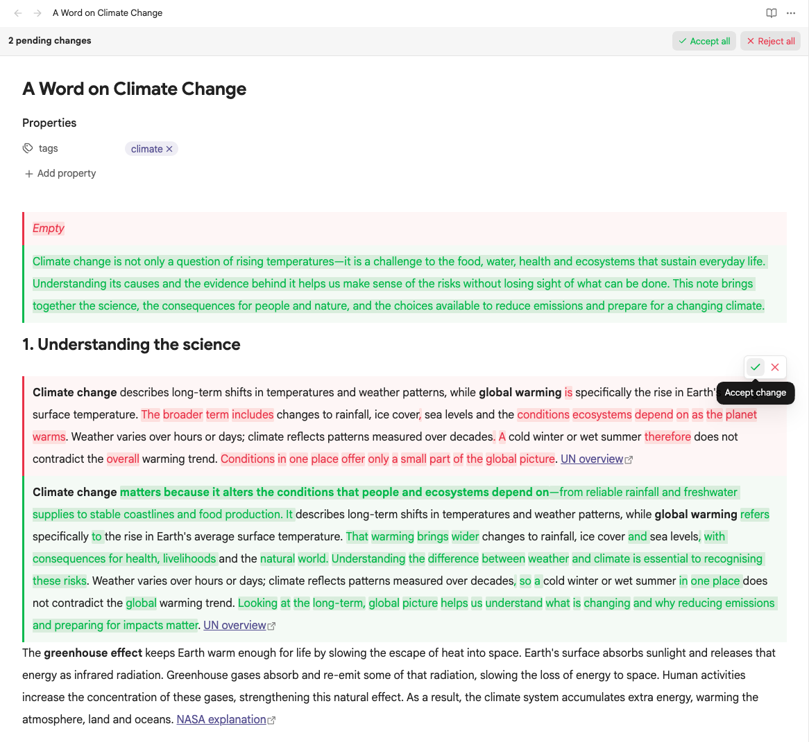

# Inline Diff

Review an agent's proposed changes to an Obsidian note, then accept or reject each edit.



Requires desktop Obsidian **1.14.5 or newer**. The tested baseline is 1.14.5 on macOS. Mobile support is not included.

```markdown
The timeout is {~~10~>30~~} seconds.

| Feature | Status |
| --- | --- |
| Export | {~~Planned~>Available~~} |

> [!note]
> {++Keep a backup before upgrading.++}
```

## Review changes

| View | Behaviour |
| --- | --- |
| Source | Editable markers with coloured additions/deletions and hover actions. |
| Live Preview | Stacked, rendered removals/additions with hover actions. Deliberately placing the text cursor inside a changed block reveals its source while editing. Agent edits render immediately, including while the editor is unfocused. |
| Reading | Rendered comparisons with no review actions or mutation commands. |

Hover a rendered change block to reveal check/X icon buttons at its top right. The buttons resolve the complete proposal and stay in the same place when you move over individual highlighted words. The toolbar floats over the note without moving text. Comparisons have no title or visible Before/After labels; the colours and side borders distinguish the alternatives, with accessible labels retained. A source section appears only for proposals whose changes are hidden by rendering, such as an unchanged link label pointing to a new destination.

For keyboard review, focus the comparison and press Enter or Space to reach the icon buttons. When a block contains several changes, floating numbered anchors appear on hover or keyboard focus for independent decisions, including ambiguous visual matches. Escape returns to the anchor. Commands in the command palette also accept/reject the current change or all changes, and navigate between changes. Assign hotkeys through Obsidian's normal Hotkeys settings.

Each note pane shows a review bar above its title when changes are pending. The bar stays visible while you scroll and counts proposals in that pane's note. In Source and Live Preview, **Accept all** and **Reject all** resolve those proposals in one undoable action. Reading and read-only panes show the count only. Split panes and popouts have their own bars; embedded notes and hover previews do not.

Every review action uses native editor history. One undo restores the proposal. Changed or stale targets are refused so an action cannot overwrite a newer edit.

Settings expose independent addition/deletion text and background colours, with theme-aware defaults and a reset button. Comparison bodies are display-only, including task checkboxes and generated Bases views. Links, callout folding, and normal media display remain available.

Rendered comparisons retain native heading, paragraph, and list spacing, including custom line heights. Code and preformatted content retain their native whitespace rules. Math and SVG changes colour the existing rendered elements without inserting spans into their glyph layouts.

See the [agent syntax guide](docs/agent-syntax.md) for structural changes, literal constructs, escaping, and exact newline rules.

## Build and deploy locally

Use Node.js 24.15.0 or newer and npm:

```sh
npm ci
npm run lint
npm test
env -u OBSIDIAN_PLUGIN_DIR -u OBSIDIAN_VAULT_DIR npm run build
```

The build produces `main.js`. Installation uses that file, `manifest.json`, and `styles.css` in the vault's `.obsidian/plugins/inline-diff/` folder.

The development workflow follows the sibling plugins:

```sh
OBSIDIAN_VAULT_DIR="/path/to/test-vault" npm run dev
```

Alternatively, `OBSIDIAN_PLUGIN_DIR` targets one installation folder explicitly and takes precedence over `OBSIDIAN_VAULT_DIR`. With a vault target, deployment discovers existing folders by manifest ID, updating matching installations or creating the canonical folder when none exists.

Both production and watch builds deploy when a target is set. Builds without a target stay in the repository. JavaScript deploys only after a successful build; the watcher also copies changes to the stylesheet and manifest. Explicit deployment failures fail production builds. Deployment copies only the three plugin assets and preserves `data.json` and other local state.

Enable or reload the plugin in Obsidian after copying a build. Automated validation uses disposable vaults; it does not install into a personal vault.

## Test in real Obsidian

```sh
OBSIDIAN_QA_THEME_ROOT="/path/to/installed/themes" npm run test:obsidian
```

The theme directory must contain Primary, Minimal, and Blue Topaz, each with its `manifest.json` and `theme.css`. Tests copy those assets into a disposable vault. No theme assets are redistributed by this repository.

The runner launches a separate app profile, verifies its disposable-vault identity, and uses a loopback debugger. It compares rich previews with Obsidian's native renderer, exercises actual hover buttons and keyboard input, verifies saved content and undo/redo, and checks themes, layout, multiple panes, popouts, external edits, and performance.

Use `OBSIDIAN_EXECUTABLE` to select a different app binary. The default is the standard macOS application location. Run the matrix or interaction suite separately with `npm run test:obsidian:matrix` and `npm run test:obsidian:interactions`. Diagnostic output and screenshots go into ignored `.qa/` files.

See [testing details](CONTRIBUTING.md), the [coverage matrix](docs/coverage.md), the [original verification report](docs/test-report.md), [pinned review-bar verification](docs/pinned-review-bar-testing.md), and [rendered-spacing verification](docs/rendered-spacing-testing.md).

## Releases

Successful pushes to `main` run semantic-release after CI checks pass. Conventional Commits determine the version, update the changelog and Obsidian metadata, and publish `main.js`, `manifest.json`, and `styles.css` with verified attestations. Release tags match the manifest version without a `v` prefix. See the [release workflow](CONTRIBUTING.md#automated-releases) for commit rules and dry runs.

## Compatibility and privacy

The storage syntax is CriticMarkup-inspired; multiline structural support is specific to this plugin. Other Markdown applications may display pending markers as text.

Obsidian's native table-cell editor can repad Markdown tables when entering or committing a cell. Review actions inside that editor preserve the same table content as native editing; outside active cell editing, resolution preserves surrounding source bytes. Existing line endings are preserved at the native save boundary for review edits.

The plugin uses no AI provider, account, telemetry, or additional remote service. Obsidian may load external resources explicitly referenced by the note. Third-party plugin syntax is outside the core-Markdown compatibility guarantee.

MIT licensed. Runtime dependency notices are included in [THIRD_PARTY_NOTICES.md](THIRD_PARTY_NOTICES.md) and embedded in the generated JavaScript.
