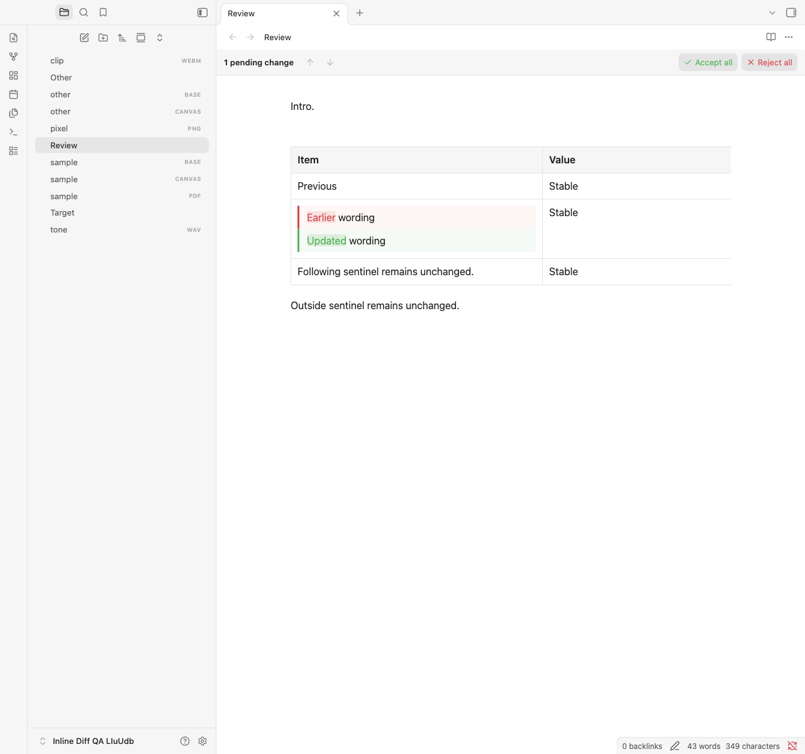
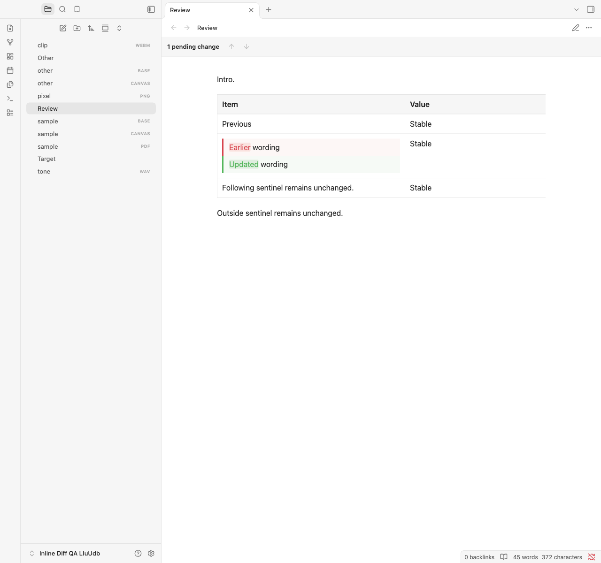
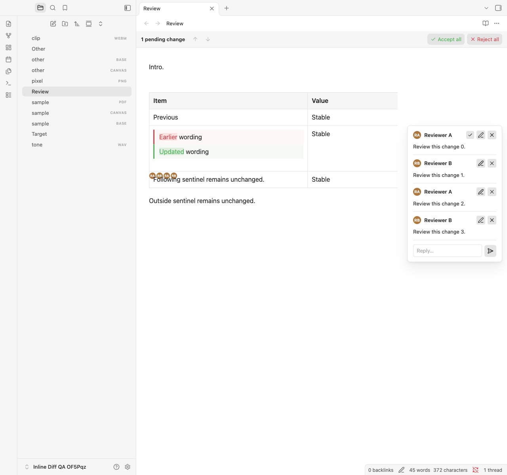

# Hidden-comment spacing correction

Each proposal still renders as one complete stacked Before/After comparison. This correction removes anonymous blank lines caused by ASCII spaces/tabs between closed hidden `%% … %%` comments at comparison boundaries. It preserves the note's source, native typography, table-cell layout and CSS overrides.

## Implementation and limits

The model uses its existing literal-aware scanner to identify closed comments and adjacent horizontal separators. It excludes indentation, line endings, hard breaks, NBSP, literal constructs and proposal-arm content. Group-level detached projection markers map exact source offsets to native rendered text nodes. DOM-offset bookmarks preserve proposal ranges while wrapping these nodes. After placement, a separator is hidden only when its otherwise empty sibling run borders a comparison. Visible prefixes/suffixes and uncertain mappings remain unchanged.

The raw rendered text stays inside an `inline-diff-comment-trivia` span. A single normal CSS rule makes that span non-rendering; no compensating margin, copied typography, native-height override or competing `!important` declaration is added. The semantic oracle unwraps the span when reconstructing either native alternative. Optional trivia-mapping failure retries the group probe without trivia, preserving a valid pending comparison.

Inline Review Comments 4.2.2 has a separate confirmed table-avatar defect. When exact source-text placement fails, its fallback appends avatars to `td` after the native `.table-cell-wrapper`. The wrapper's native `height: 100%` places the following avatar line outside its owning row. This correction leaves that plugin's code and installation unchanged. The sibling repository's `docs/inline-diff-avatar-overflow-triage.md` provides the independent implementation handoff.

## Validation method

The mandatory following-content runner disables Inline Review Comments. Seventeen fixture families cover separators before, after and between comparisons; tabs; multiple proposals in one cell; one/four comments; visible trailing spaces; paragraphs, headings, lists, callouts and code; and comparisons followed immediately by headings, code, tables or callouts. Source, Live Preview and Reading run with no snippets, the exact private current snippet copied unchanged, asymmetric padding and increased typography.

Independently authored native notes provide the references. Following content must occur once, remain outside highlights/comparisons, and retain typography, wrapping, glyph bounds and block/row height within 0.5 CSS pixels. Every editable fixture also checks individual accept/reject decisions, exact saved bytes and one-step undo/redo. The comparison-height control distinguishes native chrome from an unaccounted blank line.

The separate combined run enables the unchanged comment-plugin assets. Its avatar-overflow and following-text overlap assertions remain active and intentionally fail while that separately triaged defect is open. It must not be counted as a passing integration suite.

The complete existing 149-feature matrix, interaction, navigation, granular and override suites run unfiltered. The override suite retains Default, Primary, Minimal and Blue Topaz, light/dark palettes, narrow/wide panes, zoom, splits, popouts, runtime snippet updates, read-only Live Preview, native editing and cleanup checks. Semantic alternatives, exact serialization, stale guards and existing performance budgets remain required.

## Reproduce

```sh
npm run check
OBSIDIAN_QA_THEME_ROOT="/path/to/installed/themes" \
OBSIDIAN_QA_OVERRIDE_FILE="/path/to/current/snippet.css" npm run test:obsidian
OBSIDIAN_QA_IRC_DIR="/path/to/installed/inline-review-comment" \
OBSIDIAN_QA_OVERRIDE_FILE="/path/to/current/snippet.css" \
npm run test:obsidian:following -- --comments=combined
git diff --check
```

The combined diagnostic exits nonzero for the remaining avatar defect. Only plugin assets are copied into sentinel-verified disposable vaults; comment-plugin settings and agent configuration are excluded. Personal snippet contents and note text remain private. Fresh results, screenshots, runtime and asset hashes are recorded below and in the accompanying machine-readable evidence.

## Results — 4 November 2026

| Check | Result |
| --- | --- |
| Lint, both type checks, deployment-disabled production build, diff checks | Passed |
| Unit/component tests | 635 passed; zero failures/skips |
| Complete 149-feature Markdown matrix | 1,341 passed |
| Interaction suite | 415 passed |
| Navigation suite | 68 passed |
| Granular comparison suite | 38 passed |
| Native styling/override suite | 870 passed |
| Mandatory comments-off following-content suite | 204 passed |
| Total mandatory real-app cases | 2,936 passed |
| Separate combined-plugin diagnostic | 408 cases: 388 pass, 20 fail solely for avatar overflow/overlap |
| Plugin console/page errors | Zero in every suite |
| Runtime | Obsidian 1.15.0; Electron 43.8.4; Chromium 150.0.7871.250; Node 24.22.1 |
| Platform | macOS 27.0.1, arm64 |
| Themes | Default; Primary 2.10.0; Minimal 9.1.4; Blue Topaz 2026102001; both palettes |

With the exact snippet and IRC disabled, the synthetic commented row now matches the clean comparison control: 94.59375px in both Live Preview and Reading, including 73.59375px for the pair and 21px of native cell chrome. Two proposals occupy 168.1875px with the same 21px chrome. The following row stays 41.796875px. No unexplained separator line remains. Every following-content typography, wrapping and height assertion passes within 0.5 CSS pixels, including the combined diagnostic.

The combined failures cover five table-comment families across four override profiles in Live Preview. Avatars still overflow by 19.2890625px in the synthetic probe. Moving avatars inside the wrapper removes overflow; removing avatars leaves the same row dimensions as the comments-off control. All combined decision, saved-byte and undo/redo assertions pass. The diagnostic exits 1 and remains an open integration failure.

Source/Live Preview hover p95 is 0.4/0.4ms. For approximately 100KB / 200 proposals, initial parsing is 18.6ms and input p95 6.8ms; for 1MB / 1,000 proposals, 45.1ms and 22.7ms. Live Preview/Reading materialize 4/7 and 3/5 comparisons respectively, preserving virtualization and the existing budgets.

[Machine-readable evidence](comment-spacing-test-evidence.json) records all case results, measurements, runtime versions, exact asset hashes and screenshot hashes. The earlier [investigation](following-content-investigation.md) remains as historical reproduction evidence.

## Reviewed synthetic screenshots

Corrected Live Preview, exact snippet, comment plugin disabled:



Reading with the same unchanged snippet:



Separate remaining avatar defect with both plugins enabled:



## Local installation

The Notes installation was found by manifest ID and backed up outside the vault. Only Inline Diff's `main.js`, `manifest.json` and `styles.css` were copied. Installed hashes match the tested assets, and reloading only Inline Diff confirmed enabled identity `inline-diff:1.3.1:comment-spacing`. Inline Review Comments' code, installed assets and running instance remain unchanged.

Native UI inspection confirmed the corrected complete comparison and the separately visible avatar limitation on an existing pending table proposal. Three proven separators are hidden. The edited row decreased from 177.78125px to 156.984375px; the comparison remains 115.1875px, and the following row remains 41.796875px with unchanged computed typography. No proposal was accepted or rejected. Source and disk bytes, all pending counts, selections, complete undo/redo event content, settings, snippets and enabled states passed preservation checks. The original active view and native saved scroll positions were restored; developer tools and temporary verification state were removed.

| Asset | SHA-256 |
| --- | --- |
| `main.js` | `04c32ac88c9aae7c31127ccfb7facdff6627dbb7f68bddd027054c07f12f5641` |
| `manifest.json` | `66be1ba695af3c1bbb4414c0d278524165a492e79c2496fd10cf6f19add3a388` |
| `styles.css` | `2df637cc5ed14afaaf853f75fa596d8063becc3263007bb3d4cc8d0c037dfc53` |

This is a local installation. Commit, push and remote publication have not been performed.
