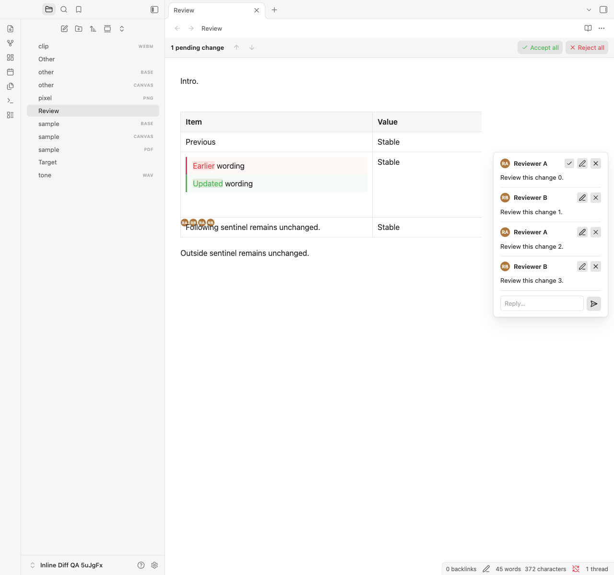

# Comparison spacing and following-content investigation

This is the historical investigation of the `native-styling` build. The subsequent Inline Diff correction and fresh validation are recorded in [comment-spacing verification](comment-spacing-testing.md). The separately owned avatar defect remains open.

Investigated on 4 November 2026. The installed `inline-diff:1.3.1:native-styling` build reproduces a real layout regression with Inline Review Comments 4.2.2. The next row's text is unchanged, but its visible area is intruded upon by avatars belonging to the preceding edited row. Plugin implementation and installed assets were left unchanged during this investigation.

## Cause

Two mechanisms combine:

1. Native Markdown rendering removes hidden `%% ... %%` comments but can leave their separating spaces after a proposal-sized block comparison. In table cells, those spaces become an anonymous line box. A trailing-space-only control is trimmed by the native Markdown parser and does not reproduce this; spaces between hidden comments do. The extra line also reproduces with Inline Review Comments disabled, including Reading view.
2. Inline Review Comments cannot match its source-text projection to a cell showing both complete alternatives. `markerPoint()` returns no point, and `rendered-markers.ts` falls back to appending avatars directly to the `td`, after its `.table-cell-wrapper`. Native Live Preview gives that wrapper `height: 100%`. The wrapper stretches to the row's allocated height, leaving its following avatar line outside the cell and over the next row.

The new passive native layout hooks exposed this interaction. The earlier styling suite loaded Inline Diff alone; it did not exercise Inline Review Comments' marker placement. Its passing results did not establish compatibility for this combination.

The offending structure is:

```html
<td>
  <div class="table-cell-wrapper">
    <!-- Complete Before/After comparison, then hidden-comment separators -->
  </div>
  <span class="irc-inline-avatar">...</span>
</td>
```

The relevant owners are `src/presentation.ts:23` in Inline Diff, and `src/marker-anchor.ts:206` / `src/rendered-markers.ts:161` in Inline Review Comments. Avatar source ownership still points to the correct row; its rendered insertion point is the problem. No proposal or comment text was moved to another row in the note.

## Measurements and isolation

In the affected personal note, the comparison measured 115.1875 CSS pixels high and its row 177.78125 pixels. The gap below the comparison was 52.09375 pixels, and avatars extended 19.2890625 pixels beyond their owning row.

A synthetic disposable-vault reproduction has shorter, single-line alternatives but the same gap and overflow:

| DOM probe | Edited row height | Gap below comparison | Avatar overflow |
| --- | ---: | ---: | --- |
| Observed structure | 136.1875px | 52.09375px | 19.2890625px into following row |
| Remove avatars | 115.390625px | 31.296875px | None |
| Move avatars inside native wrapper | 115.390625px | 31.296875px | None; avatars remain inside the cell |
| Also remove hidden-comment separators | 115.390625px | 31.296875px | Same legitimate avatar line |
| No avatars or separator-only text | 94.59375px | 10.5px | Native bottom padding/border only |

The following row remained 41.796875px high throughout. These were temporary DOM probes in disposable notes. They did not change Markdown, saved bytes or user CSS. Moving avatars into the wrapper was a causal experiment, not an installed fix.

## Regression results

The new `scripts/obsidian-following-content.mjs` suite exercises 14 fixture families in Source, Live Preview and Reading, with Inline Review Comments enabled/disabled, across four override profiles: none, the exact current private snippet, asymmetric padding, and increased typography.

Fixtures cover clean and commented cell proposals; one/four comments; literal trailing spaces; following rows and paragraphs; headings; list items; callout bodies and whole callouts; code comparisons; and comparisons immediately followed by headings, code, tables or callouts. Independent clean Markdown is the reference. Visible following text must occur once, remain outside the proposal/highlight, and retain its font, colour, wrapping, glyph dimensions and block/row height within 0.5 CSS pixels. Avatars must stay inside their owning row and never overlap following text. Cell height must be accounted for by the comparison, native cell chrome and a legitimate avatar line.

Native Live Preview lists use editable CodeMirror lines while review-owned lists use rendered Markdown. Their whitespace context is checked against a separately authored native Markdown render in the Live Preview context; other typography and dimensions retain the native-view comparisons.

| Check | Result |
| --- | --- |
| Complete cases | 336 run; 320 pass, 16 fail |
| Following text occurrence, highlight exclusion, typography, wrapping and block/row height | All pass |
| Avatars overlapping following text / leaving owning row | 8 cases fail, in Live Preview |
| Unaccounted empty cell height | 12 cases fail; four overlap the avatar failures |
| Source/saved-byte or undo-history changes | Zero |
| Plugin console/page errors | Zero |

The failures reproduce in every override profile, including no snippets. Source cases pass. Reading reproduces separator-only blank lines when comments are hidden; the native wrapper overflow is specific to Live Preview in this matrix. The suite intentionally exits nonzero while these regressions remain.

[Machine-readable evidence](following-content-test-evidence.json) records every case, asset hashes, source/preservation checks, measurements and the screenshot hash. Personal note contents, source hashes, avatars' identities and snippet contents are excluded.



## Fix requirements

- Keep marker insertion and fallback inside the native cell-content wrapper when it exists. Retain source-based row/cell ownership and one indicator per stored comment; avoid choosing an alternative by displayed words.
- Handle separator-only output left by hidden comments at comparison block boundaries, retaining exact source bytes and meaningful visible whitespace.
- Preserve native wrapper padding, typography and user snippets. Correct ownership/layout rather than adding compensating margins or competing overrides.
- Retain these following-content checks alongside the existing semantic and hover/layout suites. Test accept/reject, undo/redo and dynamic comment/proposal changes once implementing the fix.

The live personal note was inspected read-only. Its source and saved bytes, selection, undo/redo event content, active view and saved scroll position passed preservation checks. No proposals were resolved, snippets edited, plugin code changed or new build deployed.

## Reproduce

```sh
OBSIDIAN_QA_IRC_DIR="/path/to/installed/inline-review-comment" \
OBSIDIAN_QA_OVERRIDE_FILE="/path/to/current/snippet.css" \
npm run test:obsidian:following
```

Only the comment plugin's `main.js`, `manifest.json` and `styles.css` are copied into the disposable vault. Its settings and agent configuration are not copied. Synthetic comments contain no agent requests. Detailed reports remain under ignored `.qa/` files.
