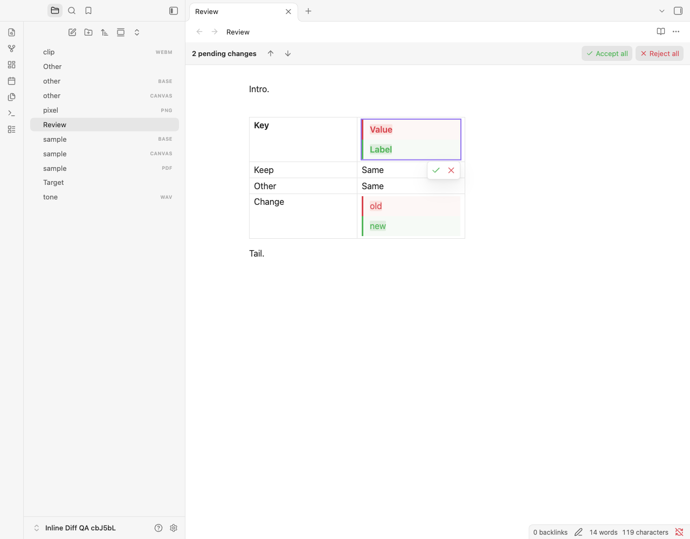
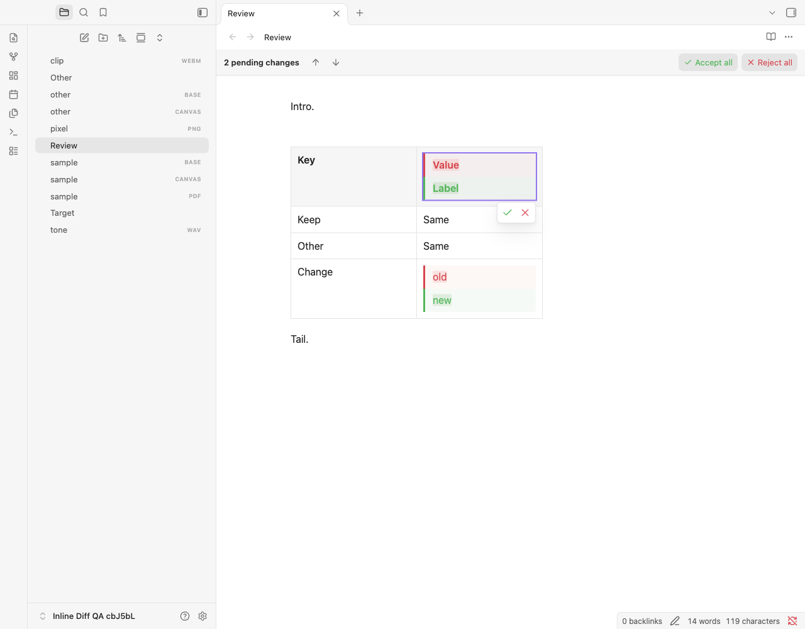
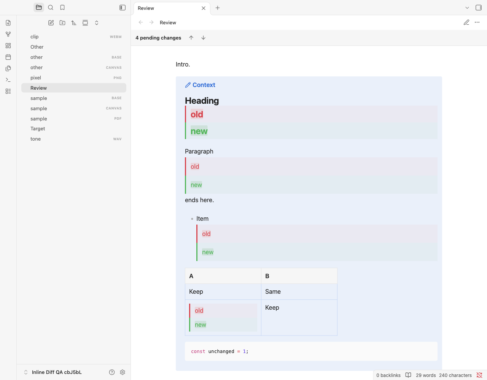

# Native styling and CSS override verification

This report records the earlier `native-styling` build. The current local correction and fresh full-suite results are recorded in [comment-spacing verification](comment-spacing-testing.md).

This work preserves proposal-sized stacked Before/After comparisons while restoring the surrounding Markdown context's native typography and table padding. The local build identifies itself as `inline-diff:1.3.1:native-styling`; it does not change marker syntax, settings, public commands or dependencies.

## Cause and correction

Live Preview's native table cells place their content in `.table-cell-wrapper`. The previous comparison table omitted that layout hook, so a snippet targeting it applied to ordinary tables but missed pending comparisons. In the reproduction, unchanged rows measured 29.796875 CSS pixels instead of the native 41.796875 pixels.

Additional `.markdown-rendered` boundaries on comparison sides reapplied percentage line-height rules below the table's own typography. Reading had a second redundant boundary below its native preview sizer, which also changed Blue Topaz's inherited typography. Comparison sides now inherit their enclosing context; Reading and embeds reuse their existing rendered ancestor. Live Preview tables receive passive native layout hooks after source placement, with no editor instances or writing controls. Render-only tables nested in callouts/lists and Reading tables retain their native structure.

No snippet is edited, selector rewritten, computed style persisted, or competing `!important` typography rule added. The comparison panel's default colours, borders and padding remain. Ordinary CSS can customize its padding. Snippet/theme changes flow through the cascade immediately; a component-owned resize observer coalesces CodeMirror measurement requests and cleans up on disposal.

## Method

The override runner renders independently authored native Markdown in a real Obsidian pane, records its computed context, then opens the corresponding pending note in the same view. It does not copy comparison typography into the native reference. Independently fixed 200-pixel fixture columns isolate unchanged row padding/height from content-dependent sizing. Actual cell/header padding, fonts, line heights, whitespace, alignment, code typography and complete comparison-side typography must match. Both native tables and pending comparisons remain visible real host output.

Nine profiles cover no snippets, the exact private current snippet, the percentage-line-height/cell-padding regression, asymmetric padding, fonts and unitless line heights, view-specific fixed line heights, variables, inherited whitespace, and ordinary comparison customization. Every profile runs across Default, Primary, Minimal and Blue Topaz in light/dark palettes, Live Preview/Reading, wide panes, narrow panes at 150% zoom, split panes and popouts. Hover and keyboard focus retain the 0.5 CSS-pixel geometry limit. Runtime checks disable, enable, edit and reload snippets with visible comparisons, reload Inline Diff with snippets enabled, and inspect read-only Live Preview. Native table editing beside pending comparisons is exercised with snippets off and with the exact snippet enabled.

The existing semantic oracle still reconstructs both complete alternatives and checks meaningful native content and structure. Only plugin-marked layout shells and the table class added by the adapter are removed. Geometry references retain the actual view's rendered-boundary topology; Typed OM's stale inherited percentage result for an empty projection is checked against resolved style before retaining unitless inheritance. These changes retain checks for empty alternatives, line heights, dimensions, line wrapping and all supported Markdown families.

## Scope and limits

The desktop runtime and final results are recorded in the accompanying evidence. Core syntax coverage remains the complete 149-feature matrix. Native Live Preview can leave nested-list tables as source; render-only structures use native rendered Markdown as their reference. Arbitrary third-party renderers or selectors requiring an exact native ancestor/child tree have no general compatibility guarantee. Minimum-version, mobile and other desktop platforms are not established by this macOS run.

Personal snippet contents and note text are excluded from repository artifacts. Only a private input's hash and synthetic measurements/screenshots are retained. Commit, push and remote publication are separate delivery steps.

## Reproduce

```sh
npm run check
OBSIDIAN_QA_THEME_ROOT="/path/to/installed/themes" \
OBSIDIAN_QA_OVERRIDE_FILE="/path/to/current/snippet.css" npm run test:obsidian
git diff --check
```

`QA_OVERRIDE_THEME` and `QA_OVERRIDE_PROFILE` narrow the new suite for diagnosis. Completion requires unfiltered runs. Logs, disposable profiles and detailed private reports remain ignored under `.qa/`.

## Final results — 4 November 2026

| Check | Result |
| --- | --- |
| Lint, normal/browser types, deployment-disabled production build, diff checks | Passed |
| Automated tests | 606 passed; zero failures/skips |
| Complete 149-feature Markdown matrix | 1,341 passed |
| Existing interaction suite | 415 passed |
| Navigation, including Source redraw regression | 68 passed |
| Granular comparisons | 38 passed |
| Native styling and override suite | 870 passed |
| Total live app cases | 2,732 passed; zero plugin console/page errors |
| Unchanged row-height / controlled column-width difference | Maximum 0 CSS pixels |
| Hover/focus movement | Within 0.5 CSS pixels |
| Desktop runtime | Obsidian 1.15.0; Electron 43.8.4; Chromium 150.0.7871.250; Node 24.22.1 |
| Platform | macOS 27.0.1 (26A434), arm64 |
| Theme fixtures | Primary 2.10.0; Minimal 9.1.4; Blue Topaz 2026102001; Default; both palettes |

The 870 override cases include 576 wide/narrow rendered-context comparisons, 288 split/popout comparisons, four runtime checks and two native editing checks. Native pointer and Enter/Escape input exercise hover/focus without resolving proposals. The complete suites ran unfiltered against the same asset hashes. Initialization waits require a real native Reading scroll position and the exact loaded snippet bytes; these prevent stale host caches from becoming reference measurements.

A Source-mode redraw regression found during validation is also corrected: temporary navigation outlines now belong to a CodeMirror decoration, so focus/configuration redraws retain them. New state and real-app tests verify that highlighting does not change selection or undo history and clears on edits/cancellation/timeout.

Source/Live Preview hover p95 was 0.6/0.5ms. For approximately 100KB / 200 proposals, initial parsing was 22.2ms and input p95 8.0ms; for 1MB / 1,000 proposals, 43.8ms and 22.2ms. Only 4/7 and 3/5 comparisons respectively were materialized in Live Preview/Reading.

See [machine-readable evidence](native-styling-test-evidence.json) for per-profile measurements, runtime details, hashes, screenshot hashes and local preservation checks.

## Reviewed synthetic screenshots

No snippets, Live Preview:



Exact current snippet copied unchanged into the disposable vault, Live Preview:



The same snippet in Reading, with heading, paragraph, list, code and a render-only callout table:



## Installed build

The Notes installation was discovered by manifest ID and backed up outside the vault. Only `main.js`, `manifest.json` and `styles.css` were replaced. Reloading only Inline Diff confirmed the enabled build identity below and matching installed hashes. Native mouse and keyboard navigation reached both existing pending proposals without resolving either. Their complete Before/After presentation and inherited typography were visually inspected. Note bytes, snippets and their enabled state, settings, selections, full undo/redo event content, other plugin instances, the original active view and native saved scroll positions passed preservation checks. Developer tools and temporary verification state were removed.

| Asset | SHA-256 |
| --- | --- |
| `main.js` | `60b6c6df56642a65aa25183411379ab0af263c8e0c02d8811e4dfdaf520cc29e` |
| `manifest.json` | `66be1ba695af3c1bbb4414c0d278524165a492e79c2496fd10cf6f19add3a388` |
| `styles.css` | `9b4bd2fe4d68f7b1cbd309897ac36ba0cf565ef7ea09f84db97565434eda6128` |

Loaded identity: `inline-diff:1.3.1:native-styling`. This is a tested local fix; it has not been committed, pushed or remotely published.
