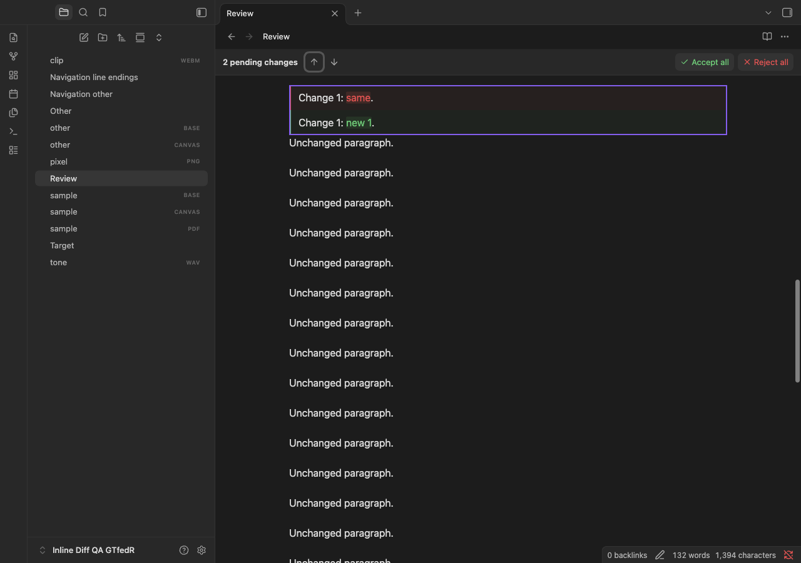
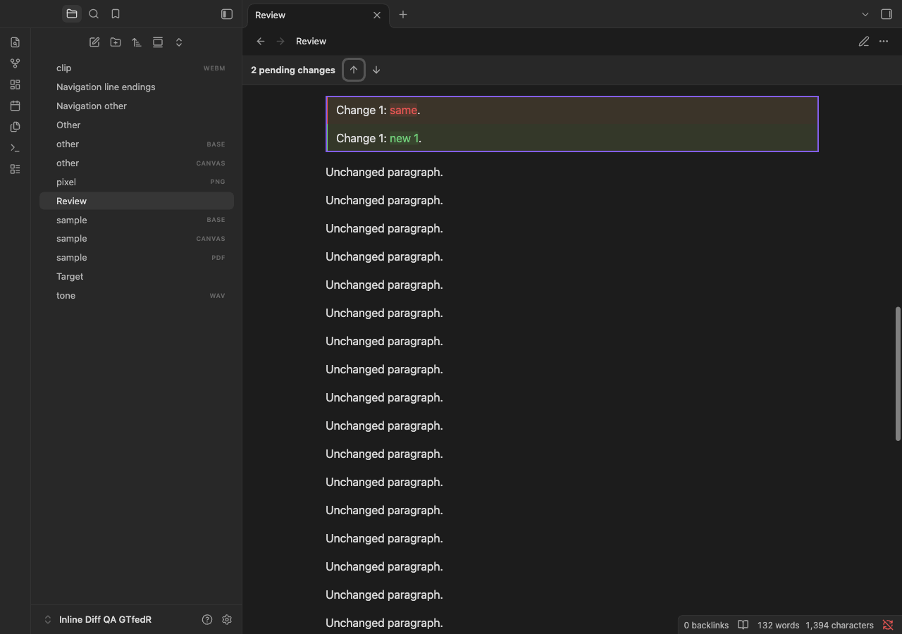
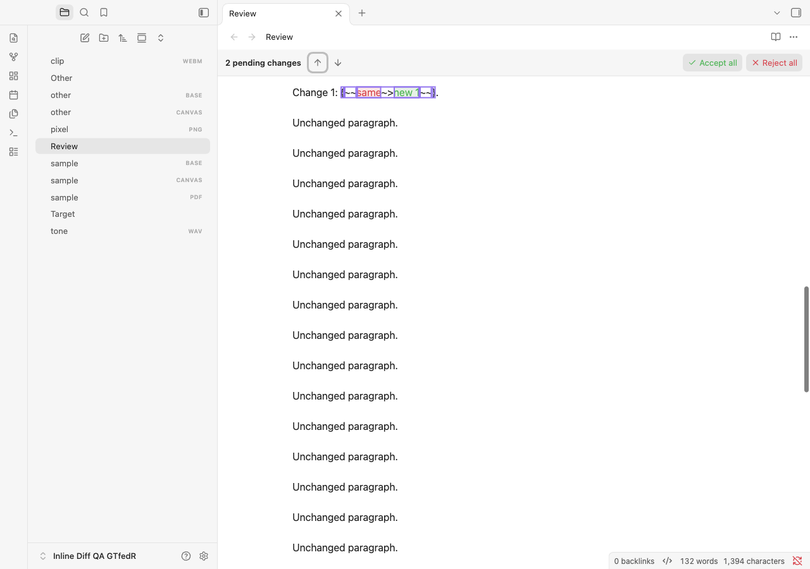

# Change navigation verification

Tested on 3 November 2026 using Obsidian **1.15.0** on macOS, with synthetic notes in disposable vaults and separate application profiles. Verification used a feature build based on 1.2.2, identified as `inline-diff:1.2.2:change-navigation`.

## Results

| Check | Result |
| --- | --- |
| Lint, normal and browser-only type checks, production build | Passed |
| Unit and component tests | 591 passed |
| Full native Markdown matrix | 1,341 passed |
| Full interaction suite | 415 passed |
| Navigation suite | 64 passed |
| Plugin console errors | None |
| Metadata, built artifacts and diff checks | Passed |

All three app suites verified identical plugin assets against the local build. [Machine-readable evidence](navigation-test-evidence.json) records the exact asset hashes, runtime, theme versions, and navigation scenarios. The runtime was Electron 43.8.4 / Chromium 150.0.7871.250. Older Obsidian versions were not exercised in this run.

## Pending-change counts

The following matrix passed independently in Source, Live Preview, and Reading:

| Pending proposals | Expected behaviour |
| --- | --- |
| 0 | Review bar hidden; navigation controls removed |
| 1 | Both arrows visible and disabled; clicks do nothing |
| 2 | Both arrows enabled; forward/backward navigation wraps |
| 12 | Every proposal reachable in both directions, including offscreen proposals |

External edits exercised **0→1→2→8→2→1→0** in every view. Individual accept/reject decisions exercised **3→2→1→0**, followed by undo/redo and bulk decisions. Reading observed those decisions from a second pane showing the same note. Read-only Source and Live Preview panes retained navigation without mutation controls.

## Interaction coverage

- Pointer and native Enter/Space activation, focus retention, accessible target announcements, viewport-based starting positions, manual-scroll resets, direction changes, and wraparound.
- Identical proposal text, multiple proposals in one comparison, table changes, multiline changes, folded headings, and literal/malformed markers.
- Cursor, nonempty selection, text, saved bytes, and undo/redo history preservation. Live Preview continued to show rendered comparisons after navigation.
- BOM/CRLF files after an individual review, matching normalized renderer offsets while preserving the exact serialized file bytes.
- Cancellation during manual scrolling, mode changes, pane closure, and plugin reload; unit tests also covered changed source/file identity and bounded render failure.
- Independent split-pane and popout navigation in all three views, plus narrow layouts and light/dark palettes. The full interaction suite additionally exercised Default, Primary, Minimal, and Blue Topaz, layout geometry, delayed content, lifecycle cleanup, and large-note performance.

The long-note tests exposed a Reading virtualization issue: native postprocessors can run before a section is attached. The coordinator now retains those source mappings until the section becomes visible; a component regression verifies detached processing and later attachment.

## UI captures

These captures contain synthetic notes only. The temporary outline identifies the navigation destination; arrow focus remains in the review bar.

### Live Preview



### Reading



### Source



## Reproduction and delivery

```sh
npm run check
OBSIDIAN_QA_THEME_ROOT="/path/to/installed/themes" npm run test:obsidian
git diff --check
```

`npm run test:obsidian:navigation` runs the navigation scenarios independently; `QA_NAV_MODE=source`, `live`, or `reading` selects one mode for diagnosis. Completion used an unfiltered run of all three app suites.

The tested app sessions have been closed. Personal-vault deployment and release publication are separate from these test results.
