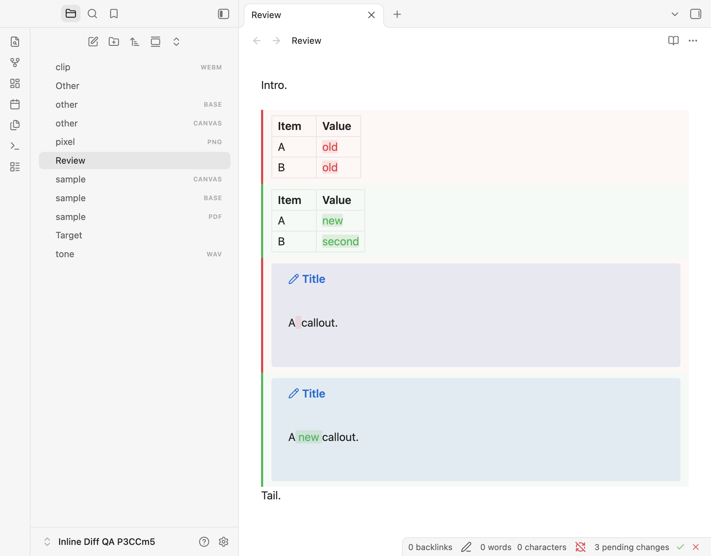
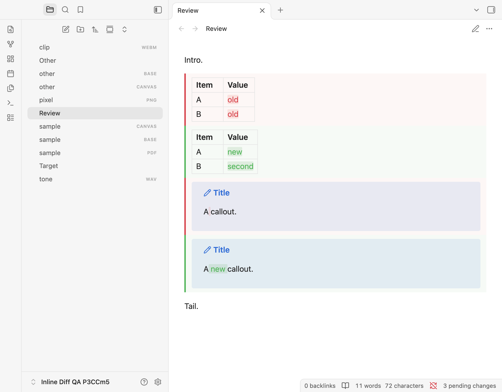

# Pending-review status verification

Tested on 31 October 2026 in disposable Obsidian profiles and synthetic vaults. This is an unreleased feature build based on 1.0.2, identified at runtime as `inline-diff:1.0.2:pending-review-status`.

## Environment and results

| Check | Result |
| --- | --- |
| Obsidian desktop / API | 1.14.5 |
| Obsidian TypeScript definitions | 1.14.4 |
| macOS | 27.0.1, build 26A434, arm64 |
| Electron / Chromium / runtime Node | 43.8.3 / 150.0.7871.250 / 24.22.0 |
| ESLint, normal and browser-only types, production build | Passed |
| Unit/component/packaging/deployment tests | 544 passed, zero failures/skips |
| Full Markdown rendering matrix | 1,323 passed, zero failures/errors |
| Full interaction suite | 115 passed, zero plugin console errors |
| Themes | Default, Primary 2.10.0, Minimal 9.1.4, Blue Topaz 2026102001; light and dark |

The interaction suite includes 22 status-specific scenarios: proposal counting in all views; exclusion of literal/malformed markers; typing, deletion and undo/redo; external agent edits and empty-file updates while unfocused; exact bulk accept/reject through mouse and keyboard; busy controls and repeated activation; stale snapshots; Reading transitions during a delayed disk check; pane switches without focus theft; read-only editor state; unsaved text; a Reading pane alongside the same editable note; non-Markdown selection; popout isolation; active native table cells; and rename/delete updates.

Theme checks compare native status-bar height before/after showing the item, and note geometry before/after hover, with a 0.5 CSS-pixel tolerance. Existing narrow-pane, horizontal scrolling, zoom, delayed content and lifecycle checks also run. The buttons use the native item's existing vertical space; the item does not enlarge the bar.

Ordinary Source/Live Preview hover p95 was 0.6/0.5 ms. Input p95 was 5.6 ms for approximately 100 KB / 200 proposals and 21.9 ms for approximately 1 MB / 1,000 proposals. Offscreen comparisons remained unrendered.

Expected stale-target notices are allowed to expire before geometry measurements, so native notices cannot obscure the top-right proposal anchors and trigger Playwright's automatic scrolling. This does not relax the geometry tolerance or skip tests.

## Reviewed screenshots

These captures contain only synthetic notes. Live Preview has a count and two bulk action icons; Reading has the count with no mutation controls.





## Tested assets

Both real-app runners installed and checked these exact assets in their disposable vaults.

Local deployment matched the same hashes and loaded runtime identity after reloading only Inline Diff. Plugin settings, enabled state, open note buffers, file identities and reply drafts were preserved. The personal vault was not used for automated review mutations. Publication was outside this verification run.

| Asset | SHA-256 |
| --- | --- |
| `main.js` | `ad116a9b69afa0da5e57f2789d78835834eda51187804f3b88385ef0d3e4300b` |
| `manifest.json` | `549bbdbe6ccc94c041ffb1dc3035aec0d5636a9c73f243f0d1ae0601ce1034ab` |
| `styles.css` | `4578129c67024e60c5bbca7df046be2b120b60684a54d19aa9a6ef27df775a92` |

## Reproduce

```sh
npm run check
OBSIDIAN_QA_THEME_ROOT="/path/to/installed/themes" npm run test:obsidian
```

For diagnosis, `QA_SECTION=status npm run test:obsidian:interactions` runs the status-specific scenarios. Full-suite logs, case names and machine-readable reports are retained in ignored `.qa/` artifacts. Existing native Markdown limitations are documented in the [original verification report](test-report.md#native-behaviour-and-limits). No mobile, Windows/Linux desktop or third-party CSS-snippet acceptance is claimed.
