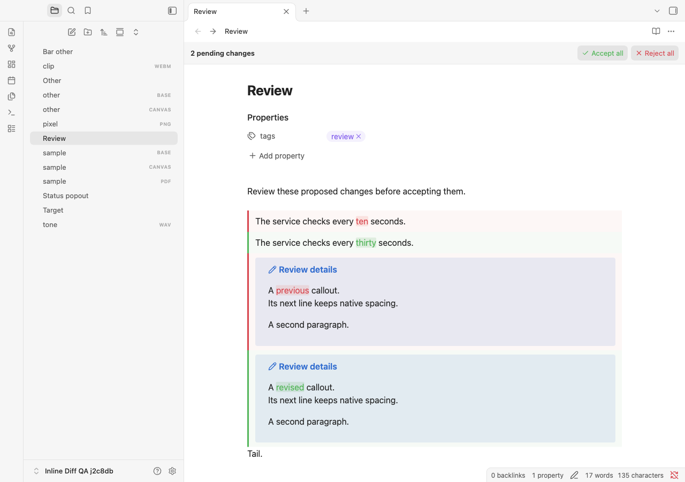
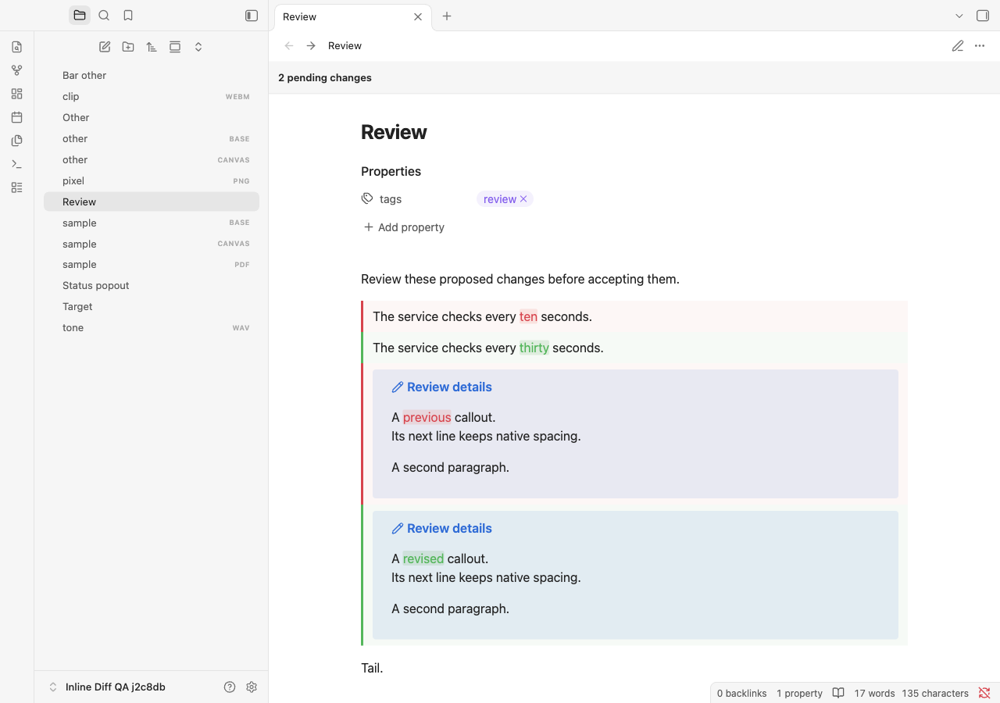

# Pinned review bar and callout spacing verification

Tested on 31 October 2026 using disposable Obsidian profiles and synthetic notes. This is a local feature build based on 1.1.0, identified at runtime as `inline-diff:1.1.0:pinned-review-bars`. Commit, push, and publication are separate from this verification.

## Environment and results

| Check | Result |
| --- | --- |
| Obsidian desktop / API | 1.14.5 |
| Obsidian TypeScript definitions | 1.14.4 |
| macOS | 27.0.1, build 26A434, arm64 |
| Electron / Chromium / runtime Node | 43.8.3 / 150.0.7871.250 / 24.22.0 |
| ESLint, normal and browser-only types, production build | Passed |
| Unit/component/packaging/deployment tests | 548 passed, zero failures/skips; includes 10,000 deterministic generated parser cases |
| Full Markdown rendering matrix | 1,323 passed, zero failures/errors |
| Full interaction suite | 210 passed, zero plugin console errors |
| Themes | Default, Primary 2.10.0, Minimal 9.1.4, Blue Topaz 2026102001; light and dark |
| Gitleaks | 8.30.1; no findings in 70 repository files and built assets, using default rules without baselines or inline allowlists |

## Pane ownership and layout

The bottom status item is removed. Each full Markdown pane owns one bar above its title and properties, outside both scrolling surfaces. Source and Live Preview have labelled bulk actions; Reading and read-only editors have only the count. Embedded notes and hover previews receive no bar.

Regression scenarios cover separate notes in split panes, same-file locking, divergent unsaved buffers, stale snapshots, repeated activation, delayed disk checks, active native table cells, external filesystem edits, rename/delete, mode changes, popout creation and migration, and cleanup. Mouse and keyboard bulk decisions check exact saved content and one-step undo/redo. Reading remains action-free beside an editable pane showing the same note, including detached old buttons and commands.

Layout checks cover visible/hidden inline titles, properties, scrolling, narrow panes, theme palettes, horizontal scrolling, and zoom. Labelled actions wrap inside their pane. Hover comparisons retain the 0.5 CSS-pixel tolerance. Floating proposal toolbars are clamped below the pinned row. The native bottom status bar retains its height.

The complete interaction run exposed a shared-selector collision at the viewport edge: a clamped toolbar could cover numbered anchors and interrupt hovering. Component and real-mouse regressions cover the fix, which moves the toolbar below the selector row or beside it when necessary. Both full suites subsequently passed against the resulting assets.

Ordinary Source/Live Preview hover p95 was 0.6/0.8ms. Input p95 was 6ms for approximately 100KB / 200 proposals and 22ms for approximately 1MB / 1,000 proposals. Only 3/6 and 2/4 comparisons respectively were rendered in Live Preview/Reading, keeping offscreen content unrendered.

## Callout spacing regression

Live Preview comparisons inherited CodeMirror's `white-space: break-spaces`. Obsidian's renderer includes formatting newlines between callout HTML elements; preserving those newlines introduced empty visual lines. Reading view already used normal whitespace.

The fix applies `white-space: normal` only to callouts inside comparison bodies. It preserves surrounding paragraph layout and native preformatted code rules. A default-theme multi-paragraph sample measured **276.796875px before the fix versus 164.796875px natively**. After the fix, both comparison alternatives measure **164.796875px**, matching the native callout in the same view at the same width.

There are 64 native callout comparison scenarios: multi-paragraph, nested/list, code/math, and folded callouts, in Live Preview and Reading, across four themes and both palettes. Each compares the structure, visibility, computed whitespace, line heights, and descendant geometry with independently rendered clean notes. Every measured coordinate must agree within 0.5 CSS pixels. These checks supplement the full syntax matrix's addition/deletion/replacement cases.

## Reviewed screenshots

Captures contain synthetic notes only. The Live Preview bar has labelled actions; Reading has no review actions. Both show native callout line spacing.





## Tested assets and local deployment

Both real-app runners installed and verified the following exact assets. Local deployment used a backup outside the vault and copied only the three plugin assets. Installed hashes matched both reports. Reloading only Inline Diff produced a fresh constructor and the expected `inline-diff:1.1.0:pinned-review-bars` runtime identity.

Runtime checks confirmed pane counts/actions, removal of the old status item, and preservation of settings, open buffers, file identities, and reply drafts. The settings-file state and enabled-plugins file remained unchanged. Developer Tools were closed afterward, restoring the existing note view. Automated review mutations were confined to disposable vaults; no personal proposals were accepted or rejected.

| Asset | SHA-256 |
| --- | --- |
| `main.js` | `ed5576c4a4b6d0c2aa3cea9b331f0746a66033c705e4f282427a544d9067223b` |
| `manifest.json` | `c974ea8e7ba9d187aec3e18264236ec08977d400c33844459eaf32ae032aaf19` |
| `styles.css` | `efe534e6e28a56bf7a885bc3966480fc502cf54ff550db74f7c9ff3821992356` |

## Reproduce

```sh
npm run check
OBSIDIAN_QA_THEME_ROOT="/path/to/installed/themes" npm run test:obsidian
git diff --check
```

For diagnosis, use `QA_SECTION=status`, `QA_SECTION=bars`, or `QA_SECTION=themes` with `npm run test:obsidian:interactions`. An unfiltered run is required for completion. Machine-readable reports and logs remain in ignored `.qa/` artifacts. See the [original report](test-report.md#native-behaviour-and-limits) for native Markdown limitations. This run does not claim mobile, Windows/Linux desktop, or arbitrary third-party CSS-snippet acceptance.
