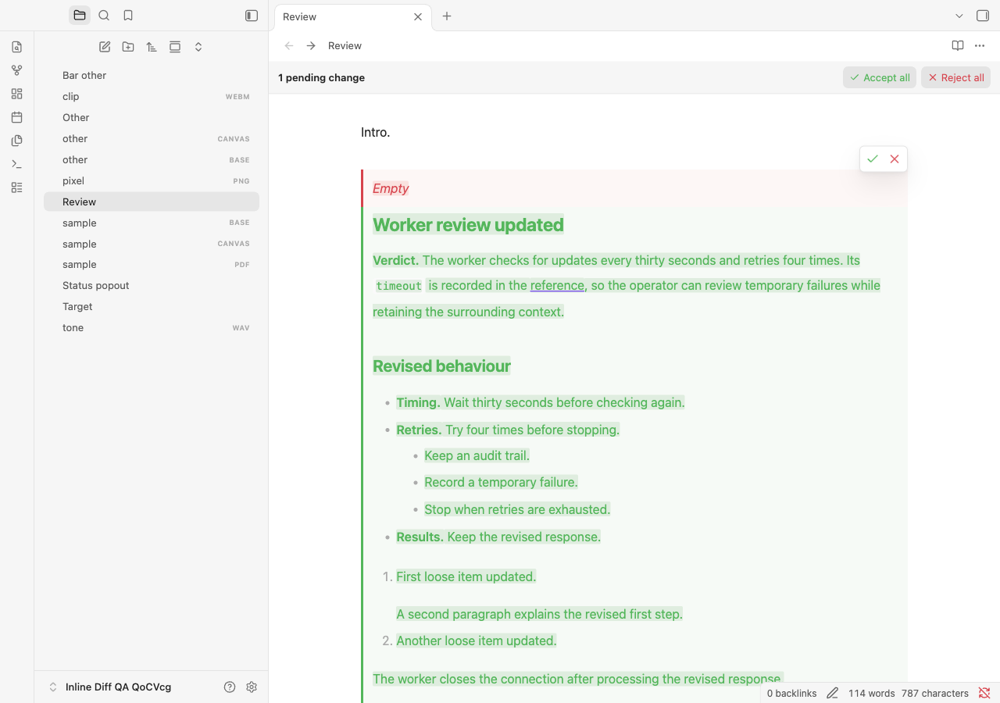
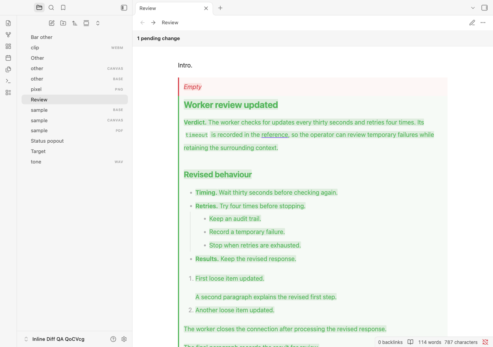

# Rendered Markdown spacing verification

Verified on 1 November 2026 on macOS desktop with disposable profiles and synthetic notes. This local build is based on 1.2.1 and identifies itself as `inline-diff:1.2.1:native-block-spacing`. Commit, push, and publication are separate steps.

## Cause and correction

Live Preview comparisons inherited CodeMirror's `white-space: break-spaces`. Highlighting also wrapped the renderer's formatting newlines in inline spans, breaking native block adjacency. A local note's section measured 1,480.109375px versus 1,008.109375px natively at the same 1,673px width and 32px line height. Resetting whitespace alone measured 984.109375px because the highlight elements still interrupted native heading spacing.

Comparison bodies now use normal Markdown whitespace. Structural separators retain their text and offsets without highlight wrappers. Classification uses that intended whitespace even when an existing editor renders before the plugin stylesheet finishes reloading; it restores the original style attribute immediately. The final local check caught this reload timing case, and dedicated component and real-app regressions now cover it. Preformatted content, inline spaces and NBSP remain intact. Separator-only differences retain source evidence. MathJax and SVG glyphs receive colour classes on their existing elements, avoiding HTML spans that change glyph layout.

The reference renderer remains outside the real editor, retains the view's theme context, and preserves unitless line-height inheritance for smaller inline-code fonts. It compares the actual highlighted DOM with clean native Markdown. Geometry checks do not strip marks or normalize whitespace, and retain the 0.5 CSS-pixel tolerance. Internal native margins are preserved; the comparison's established outer-edge treatment is shared by both sides of the measurement.

## Environment and results

| Check | Result |
| --- | --- |
| Obsidian desktop / API | 1.14.5 |
| Obsidian TypeScript definitions | 1.14.4 |
| macOS | 27.0.1, build 26A434, arm64 |
| Electron / Chromium / runtime Node | 43.8.3 / 150.0.7871.250 / 24.22.0 |
| Lint, normal/browser types, production build | Passed |
| Unit/component/packaging/deployment tests | 564 passed, zero failures/skips; includes 10,000 generated parser cases |
| Full Markdown matrix | 1,341 passed, zero failures/errors |
| Full interaction suite | 415 passed, zero plugin console errors |
| Themes | Default, Primary 2.10.0, Minimal 9.1.4, Blue Topaz 2026102001; light/dark |
| Gitleaks | 8.30.1, 75 repository files and built assets, zero findings; default rules, no baseline or inline allowlists |

The expanded matrix has 149 features and 447 proposal fixtures. Complete-section cases cover both decisions, exact saved content, one-step undo/redo, and Reading action exclusion. Geometry coverage adds 192 primary section scenarios across proposal types, views, widths, themes/palettes, and native/200% line heights, plus 12 combined-whitespace cases. These cover nested callouts, tables, inline/fenced/indented code, math, HTML preformatted content, soft/hard breaks, Unicode and NBSP. Empty alternatives are checked against the existing explicit placeholder.

Source/Live Preview hover p95 was 0.5/0.5ms. Input p95 was 8.3ms for approximately 100KB / 200 proposals and 25.1ms for approximately 1MB / 1,000 proposals. Initial parse times were 20.9ms and 45.1ms respectively. Only 3/6 and 2/4 comparisons respectively were rendered in Live Preview/Reading, leaving offscreen content unrendered.

## Reviewed synthetic screenshots

These show the 200% line-height reproduction. Live Preview has review controls; Reading has no mutation actions. No personal note text or screenshots are retained in this repository.





## Tested assets and local verification

Both complete app suites installed and verified these exact assets. The local vault has the same build loaded, verified after reloading only Inline Diff. Current assets and settings were backed up outside the vault before replacement; only the three plugin assets were copied. Installed hashes, runtime identity, enabled state, open buffers, file identities, textarea drafts, other enabled plugins, and snippets all passed preservation checks. Vault configuration and plugin settings remained unchanged.

| Asset | SHA-256 |
| --- | --- |
| `main.js` | `eb5c140f1e34f9198f3b21c8df53b8311c74c10917be4cf4acfa7c5a6922ee88` |
| `manifest.json` | `5864eebe718efde9c0b765f40cc2d3776a384ff3cc75182cfb0c29bc4f6e7e22` |
| `styles.css` | `05ac847dcf236ae9048d4be79772c2e3a33ba2ac54e85dcde0e66e04ffb643b0` |

The affected local section was visually rechecked with other plugins and the `overrides` snippet enabled. At the current 1,673px content width and 32px line height, its final height was **1,008.109375px**, exactly matching native rendering. All 13 measured blocks had a maximum position/dimension difference of **0px**, and rendered text matched. The note's editor and disk hashes were unchanged, with all eight proposals still pending. The temporary inspection pane and native-render probes were removed and the original pane restored. No private note text or screenshots were copied into this repository.

## Reproduce

```sh
npm run check
OBSIDIAN_QA_THEME_ROOT="/path/to/installed/themes" npm run test:obsidian
git diff --check
```

For diagnosis, `QA_SECTION=spacing` selects the new geometry cases; `QA_SPACING_FILTER` narrows their case names. Completion requires an unfiltered run. Machine-readable reports, backups, profiles, and logs remain ignored under `.qa/`. Existing native limitations remain documented in the [original report](test-report.md#native-behaviour-and-limits). This run does not establish mobile or Windows/Linux desktop support, or compatibility with arbitrary third-party syntax and CSS.
