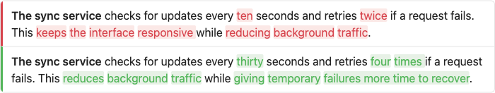
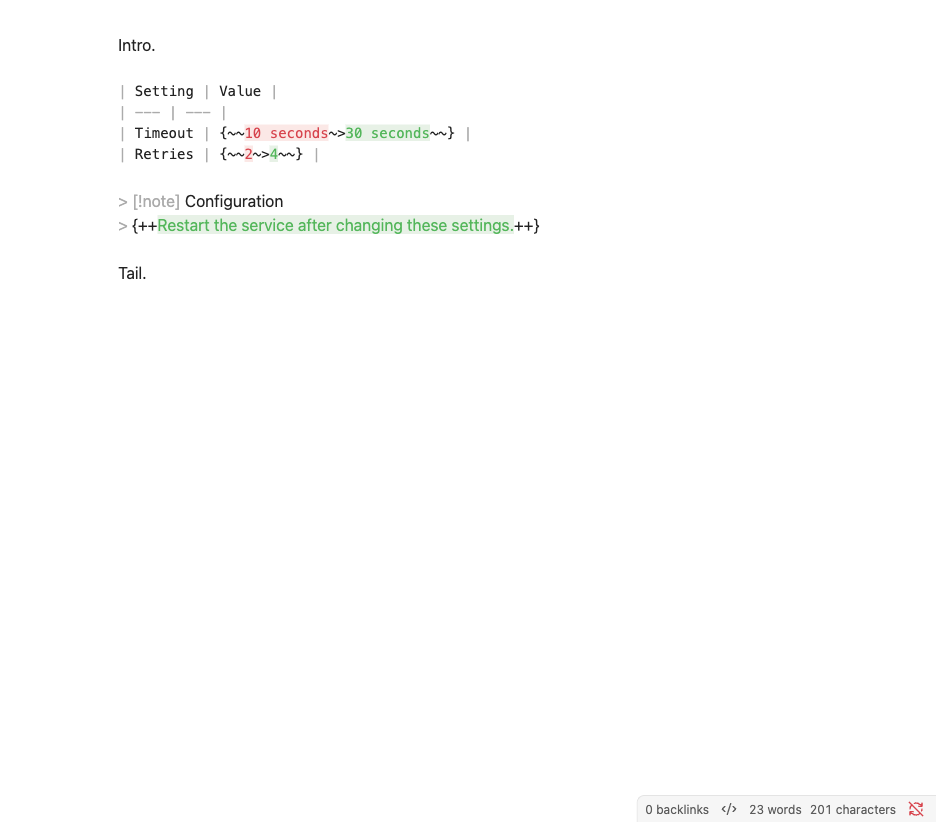
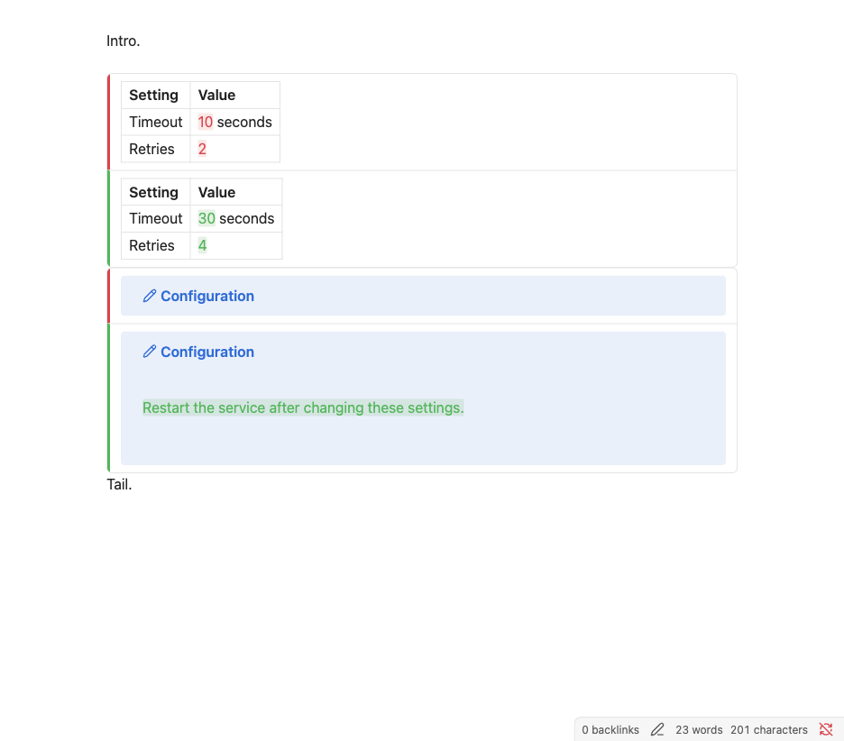
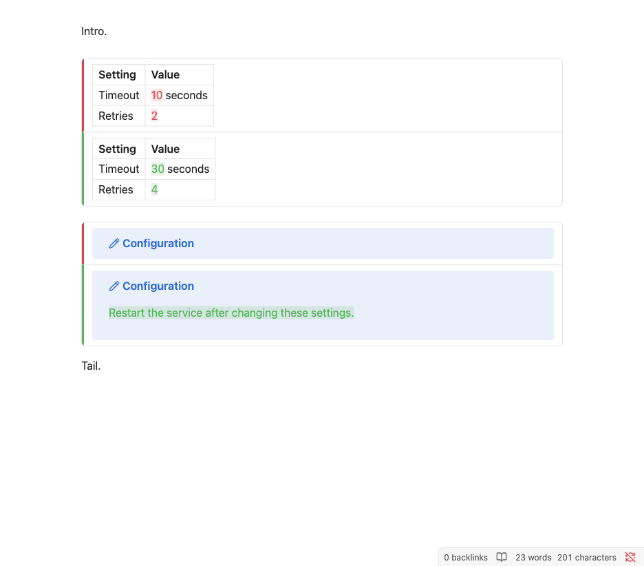
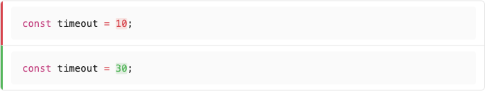

# Verification report — Inline Diff 0.1.0

Tested on **31 October 2026**, using disposable application profiles and synthetic vaults. All applicable cases passed, with no skipped tests and no plugin-attributable console errors. Local deployment was verified separately. Mobile acceptance and publication were outside this run.

## Exact environment

| Item | Version |
| --- | --- |
| Obsidian desktop / installer / runtime API | 1.14.5 |
| Obsidian TypeScript definitions | 1.14.4 |
| macOS | 27.0.1, build 26A434, arm64 |
| Machine | Apple M5 Max, 18 CPU cores, 128 GB RAM |
| Electron / Chromium | 43.8.3 / 150.0.7871.250 |
| Node inside Obsidian | 24.22.0 |
| Build Node / TypeScript / esbuild | 26.8.2 / 5.9.3 / 0.25.5 |
| Playwright / ESLint | 1.64.1 / 9.39.5 |
| CodeMirror state / view development packages | 6.7.6 / 6.43.13 |
| Primary / Minimal / Blue Topaz | 2.10.0 / 9.1.4 / 2026102001 |

The default theme and all three community themes ran in light and dark palettes, across Source, Live Preview, and Reading.

## Results

| Layer | Result |
| --- | --- |
| Clean lockfile installation | Passed; npm audit reported zero vulnerabilities |
| ESLint, normal types, browser-only types | Passed |
| Unit, component, packaging and deployment tests | **509 passed**, zero failures/skips |
| Seeded generated transformations | **10,000 passed**, seed `0x0194af32` |
| Real-app Markdown matrix | **1,323 passed**, zero failures/errors |
| Real-app interaction suite | **71 passed**, zero errors |
| Production build and metadata checks | Passed |
| Installed asset hashes and loaded runtime identity | Verified in disposable instances |
| Source/documentation whitespace checks | Passed |

The [coverage matrix](coverage.md) lists 147 core-syntax features, each exercised as addition, deletion, and replacement in all three views. Independently authored expected Markdown drives native-render comparisons. The editable matrix performs **1,764 individual button resolutions**, checking exact saved content, one-step native undo, and redo. Additional boundary fixtures cover empty documents/arms, adjacency, frontmatter, and document edges.

The interaction suite verifies floating controls without text/table/scroll-layout movement beyond **0.5 CSS pixels**. It covers real keyboard and pointer input, default/custom colours, settings/reset UI, independent table proposals, active native cell editors, duplicate text, identical-content files, unsaved buffers, delayed reads, focus changes, filesystem agent edits, renames, multiple panes, read-only Reading shortcuts/clicks, embeds and native hover previews, disabled tasks, inert Bases, delayed images, folding, narrow panes, horizontal scrolling, zoom, popouts, and repeated unload/reload/open/close cycles.

New Live Preview regressions cover filesystem edits with the remembered cursor inside/outside the changed paragraph, editor/sidebar focus, two panes, direct acceptance without first clicking the editor, and native undo. Deliberate typing still reveals source; blur restores comparisons without collapsing an active native table-cell editor. Compact-layout checks verify the absence of visible titles/side labels and ordinary source sections, accessible side names, independent proposal controls, hidden link-destination evidence, and Enter handling on rendered links.

Exact-byte regressions include BOM, CRLF, mixed endings, and final-newline state. Identical Before/After text with different newline styles is tested through both choices and native keyboard undo/redo.

## Performance

Measurements are milliseconds on the recorded machine. Input samples measure synchronous editor transaction handling over 20 edits; the reported percentile conservatively includes the maximum sample. Hover samples include toolbar positioning and layout reads. These are local acceptance measurements, not guarantees for other hardware.

| Fixture | Initial input | Input p95 | Visible Live Preview comparisons | Reading comparisons |
| --- | ---: | ---: | ---: | ---: |
| Approximately 100 KB, 200 proposals | 28.4 | 7.7 | 3 | 6 |
| Approximately 1 MB, 1,000 proposals | 42.8 | 22.1 | 2 | 4 |

Ordinary Source hover p95 was **0.4 ms**; Live Preview hover p95 was **1.1 ms**. Both input and hover stayed below the 100 ms target. Offscreen comparisons remained unrendered.

## Tested artifacts

Each runner copied only `main.js`, `manifest.json`, and `styles.css` into its verified disposable vault. It compared their bytes with the checkout and confirmed loaded identity `inline-diff:0.1.0:live-preview-refresh` in a fresh application instance. Settings were preserved by deployment tests.

The local installation matched the same hashes after reloading only Inline Diff. Its loaded build identity and enabled state were verified, with existing note buffers, reply drafts, and plugin settings preserved.

| Asset | SHA-256 |
| --- | --- |
| `main.js` | `72196a0b34e96e1590f7a090be0e3a652d3ea36451d3743d8522b54d29cf0d40` |
| `manifest.json` | `8bc36e38cd1eaf8a01fbbf6b01372a2067b94e20e244483a023572f35edba15c` |
| `styles.css` | `b28ea91e53a761a7076ebdae09093caa053c2f13b42139c425d33a2b0f685452` |

The complete case names, timestamps, runtime versions, hashes, and measurements are retained in [machine-readable evidence](test-evidence.json).

## Reviewed screenshots

These are actual app captures from synthetic notes, inspected before retaining them. Source shows distinct foreground/background colours without accidental delimiter strike-through. Live Preview preserves native table/code styling; Reading has no review controls. Toolbar icons remain visible in the tested themes.











Theme captures: [Primary dark](images/primary-dark.png), [Minimal dark](images/minimal-dark.png), [Blue Topaz light](images/blue-topaz-light.png).

## Native behaviour and limits

- Obsidian's active table-cell editor can repad Markdown tables. That regression compares semantic cell content with an independent native edit and checks one-step undo. Ordinary review cases compare complete file bytes exactly.
- PDF.js generates asynchronous internal DOM. PDF comparisons check stable destinations and page/height options instead of transient viewer internals. Other previews compare meaningful native structure and destinations.
- Obsidian normalizes editor line endings and strips a BOM on a fresh text read. The plugin preserves the selected raw format at the native serialization boundary; this behaviour has exact unit and real-app tests.
- A bare image path can resolve to a vault-root match when both root and local files exist. Explicit `./pixel.png` follows the note after a rename, matching native link resolution.
- The native frontmatter helper does not treat an unclosed leading `---` as frontmatter. That boundary is tested as body Markdown.
- No Windows/Linux desktop, mobile-device, arbitrary CSS-snippet, or third-party Markdown-extension acceptance is claimed.

## Reproduce

```sh
npm ci
npm run check
OBSIDIAN_QA_THEME_ROOT="/path/to/installed/themes" npm run test:obsidian
```

`npm run check` explicitly disables deployment for its production build. The real-app runner requires the three named theme fixtures and refuses a vault without its generated ownership sentinel. Its fixture loader flushes/closes previous editors, opens a fresh view, waits for current native data/rendering, and positions the viewport before assertions. Geometry baselines wait for fonts and finite layout transitions to settle; the hover tolerance remains 0.5 CSS pixels.

See [contributor instructions](../CONTRIBUTING.md) for separate suite commands, diagnostic filters, and deployment verification.
